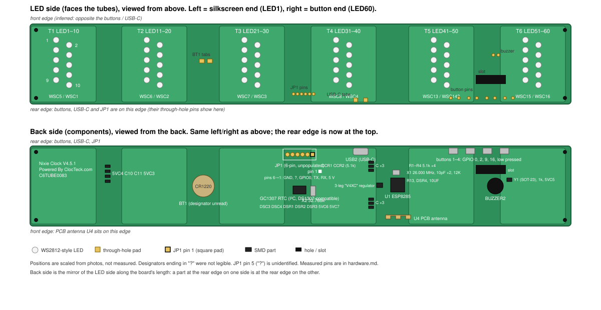

# Board diagram: "Nixie Clock V4.5.1" (`FW-HW`, reference)

What the CT-001's single PCB looks like, from the user's photos taken on 2026-11-02/03 and the close-up reshoots of 2026-11-03 (`board_pics/reshoots/20261103_145910`–`150309`, referenced below by their time suffix). This page is reference material for [hardware.md](hardware.md); it has no requirements of its own. Everything marked *inferred* must be confirmed by OQ-02's measurements before any code depends on it.

The SVG shows both sides with the same left/right orientation: left = the end with the "Nixie Clock V4.5.1" silkscreen and LED1, right = the end with the buttons and LED60. The rear edge (buttons, USB-C, JP1) is at the bottom of the LED-side view and at the top of the back-side view.

## Shape and orientation

- One long, narrow two-layer PCB (about 6.5:1), stepped: it widens into six "tube pads", one under each tube, with narrower necks between them. Four mounting holes, one in each corner. Photos: 20261102_232414 (back), 20261102_232423 (LED side).
- LED side faces up into the tubes. Back side carries every other component.
- The buttons, the USB-C port and JP1 all sit on the same long edge. The brief says the buttons are on the clock's rear, so that edge is the **rear** (inferred).
- **Tube order as seen from the front:** with the LED side up and the rear edge away from the viewer, the LED1–10 end is on the viewer's **right** and the LED51–60 end on the viewer's **left**. Confirmed by the observations below, so the stock firmware's tube 1 (the viewer's leftmost tube) is LED51–60, not LED1–10.
- **Observed 2026-11-03 (stock firmware):** `clocteck color 1` lit the **leftmost** tube as the user faces the clock. So stock tube 1 = viewer's left = hours-tens.
- **Observed 2026-11-03 (user, assembled clock):** the LED51–60 block is under the viewer's **leftmost** tube and LED1–10 under the rightmost. That matches the orientation above. So stock tube 1 (left, hours tens) = LED51–60, and API tube `t` (1–6) is block `7 - t`. Digits confirmed on 2026-11-06: LED51 is the leftmost tube's 0 and LED1 the rightmost tube's 0, each counting up one digit per label (FW-DSP-002).

## LED side

| Item | What the silkscreen shows | Confidence | Photo |
|---|---|---|---|
| Tube pads T1–T6 | Six blocks of ten 5050 LEDs: T1 = LED1–10 at the silkscreen end, then LED11–20, 21–30, 31–40, 41–50, T6 = LED51–60 at the button end. | Confirmed (labels read on every block) | 232515, 232512, 232510, 232507 |
| Rows inside a block | Two rows of five across the board's width, offset along its length: odd LEDs (n, n+2, … n+8) in the row nearer the LED1 end, even LEDs in the row nearer the LED60 end. Even-row labels are printed rotated 180°, so those LEDs are mounted rotated. | Confirmed | 232515 (LED1–20 clearest) |
| Order inside a row | LED1 (and LED2) nearest the front edge, LED9 (and LED10) nearest the rear edge. | Inferred from label positions | 232515 |
| Decoupling caps | One 0603 cap at each end of each block: WSC5/WSC1 (T1), WSC6/WSC2 (T2), WSC7/WSC3 (T3), WSC8/WSC4 (T4), WSC13/WSC14 (T5), WSC15/WSC16 (T6). WSC9–12 are not populated anywhere on the LED side. | Confirmed | reshoots 150106, 150157, 150140 |
| LED data chain | Data is GPIO 13, GRB. The chain visits LED10→1, LED20→11, LED30→21, LED40→31, then jumps to LED51→60 and back to LED41→50. So LED10 is chain index 0, not LED1. | Measured with the pin-finder (FW-HW-004, FW-DSP-002) | video 20261106_235633 |
| Through-holes on this side | Coin-cell holder tabs between T2 and T3; JP1's six pins between T3 and T4 at the rear edge; USB-C shell tabs beside T4 at the rear edge; buzzer pins between T5 and T6; eight button pins along the rear edge beside T5/T6, next to a rectangular slot. | Confirmed | 232423, 232507, 232510 |

## Back side

| Designator | Part | Confidence | Photo |
|---|---|---|---|
| U1 | ESP8285, QFN-32. Marking, verbatim: `ESP8285` / `162024` / `N08AP2L545` / `HB00MBD006`. Pin-1 dot is at the corner nearest X1 and the `12K` resistor. Designator reads `U1` (small, partly under the chip). | Confirmed part and marking; designator low-confidence | reshoots 150028, 151238, 151247 |
| X1 | 26.000 MHz crystal, with two `10PF` caps and a `12K` resistor beside the ESP. | Confirmed | 232448 |
| U4 | PCB meander antenna on the front edge next to the ESP. | Confirmed | 232448 |
| R13, DSR4, `10UF` | Resistor, resistor, capacitor near the ESP. Function unknown. | Confirmed designators | 232448 |
| — | 3-leg SOT-23 between the USB-C and the ESP, between the two banks of three caps, with its single leg away from the ESP: the regulator. Single leg = 5 V in; the two legs toward the ESP are ground and output (continuity, 2026-11-06). Marking, verbatim: a logo glyph then `V4XC`. Not matched to a known part number; its output voltage is still to be measured (item 9 below). | Legs measured; part identity inferred | reshoots 151230, 151247, 151445; regulator photos 20261106_222452, 222458 |
| — | Two banks of three 0805 caps either side of the ESP. Designators not legible. | Confirmed parts | 232448 |
| USB2 | USB-C receptacle on the rear edge beside T4. | Confirmed | 232448 |
| CCR1, CCR2 | Two `512` (5.1 kΩ) resistors: CC1/CC2 pull-downs, so the port only requests 5 V power. No USB data traces to a bridge chip were seen. | Confirmed values; "power only" inferred | 234029, 232448 |
| JP1 | 6-pin 2.54 mm through-hole header labelled `JP1`, unpopulated, outlined on silkscreen, at the rear edge between T3 and T4. **Pin 1 = square pad, at the end nearest USB-C/the button end.** Four traces leave the inner pads and run as a bundle toward the ESP/LDO area; the two end pads are power and ground. Pin 1 = 5 V, 2 = ESP RX, 3 = ESP TX, 4 = GPIO0, 5 = unidentified, 6 = GND. | Measured 2026-11-06 ([hardware.md](hardware.md)) | 234029, reshoots 151526, 151530 |
| X2 | 32.768 kHz cylindrical crystal next to the SOIC-8. | Confirmed | 234029 |
| (RTC) | SOIC-8 beside X2, powered from the coin cell. Marking, verbatim: `GC1307` / `TMTV28`. GC1307 is a DS1307-compatible **I²C** RTC (7-bit address 0x68, 56 bytes RAM, SQW output), not the SPI-like DS1302 assumed before. Its own designator is hidden; `DSR1` printed nearby belongs to a resistor. | Confirmed marking; "DS1307-compatible" inferred from the part number | reshoots 150034, 145946 |
| DSC3, DSC4 | Crystal load caps for X2. | Inferred | 234029 |
| DSR1, DSR2, DSR3 | Three `512` (5.1 kΩ) resistors on the RTC's pin side: consistent with I²C pull-ups on SDA and SCL plus one on SQW. SDA is GPIO 4 and SCL is GPIO 5; GPIO 10 toggles once a second untouched, likely SQW (FW-HW-010). | Confirmed values; function inferred | reshoot 150034 |
| 5VC6, 5VC7 | Caps near the RTC; `5VC` prefix suggests 5 V-rail decoupling. | Inferred | 234029 |
| BT1? | CR1220 holder in the middle neck (designator hidden under the holder). | Confirmed part | 232452 |
| 5VC4, C10, C11, 5VC3 | Four caps in a column near the silkscreen end. | Confirmed | 232459 |
| BUZZER2 | 12 mm piezo/magnetic buzzer with a `+` mark, near the button end. | Confirmed | 232440 |
| Y1 | SOT-23 transistor (silkscreen `Y1`, confirmed) with a `102` (1 kΩ) base resistor and cap 5VC5 beside BUZZER2: the buzzer driver. GPIO 15 high sounds the buzzer (FW-HW-010). The transistor's own marking is not legible. | Confirmed designator and resistor value; drive level measured | reshoots 151430, 151459, 151504 |
| — | Four right-angle tactile switches on the rear edge at the button end, numbered `1`–`4` on the silkscreen under their pins (1 nearest the USB-C end). In that order they read GPIO 0, 2, 9, 16, low when pressed (FW-HW-010). | Confirmed | reshoots 150305, 150309 |
| R1, R2, R3, R4 | Four `512` (5.1 kΩ) resistors in two pairs below the buttons: button pull-ups or series resistors. The buttons read low when pressed, and GPIO 16, which has no internal pull-up, reads high idle, so the board pulls up (FW-HW-010). Which resistor does what was not traced. | Confirmed values; pull direction measured; individual function inferred | reshoot 150028 |
| Silkscreen | `Nixie Clock V4.5.1`, `Powered By ClocTeck.com`, `C6TUBE0083` at the LED1 end. | Confirmed | 232459 |

Trace routing: the LED-side photos show a bundle of traces fanning out from the T4/T5 neck toward JP1 and the ESP (232510), and single traces running the length of the board between blocks. On the LED side one trace leaves the LED1 block along the board edge toward the T1/T2 neck (video 145824, frames 1–2). LED1 is not the chain's data input (LED10 is chain index 0, FW-DSP-002), so this is probably LED1's data out on its way to LED20, but it was not followed. Nothing was followed end to end.

The four reshoot videos (`20261103_145751/145824/145844/145853.mp4`, reviewed as 1 fps frames at 1600 px) are whole-board sweeps at lower resolution than the stills; they confirm the layout above but add no new markings. The second reshoot set (`board_pics/reshoots_2/20261103_151230`–`151549`) settled the LDO marking, the ESP designator and the buzzer resistor.

## What must be confirmed (OQ-02)

Measure with a multimeter (continuity, board unpowered) and the pin-finder build (FW-HW-004). Record results in [hardware.md](hardware.md) and mark the rows above *Confirmed*.

1. **JP1 pinout.** Done 2026-11-06 except pin 5, which is still open: 1 = 5 V, 2 = ESP RX, 3 = ESP TX, 4 = GPIO0, 6 = GND. Pin 5 idles near 3.6 V and is probably reset or enable; beep it to the ESP's RESET and CHIP_EN pins.
2. **LED data GPIO.** Done 2026-11-06: GPIO 13 (pin-finder).
3. **LED chain order.** Done 2026-11-06: index 0 is LED10, and the order is in FW-DSP-002. Digit order was seen by eye on the two end tubes; the right digits on the assembled clock are still checklist 3.
4. **Color order.** Done 2026-11-06: GRB.
5. **Which LED block is under the viewer's leftmost tube.** Done: LED51–60, by eye (see above). `LedLayout` maps tube 0 → LED51–60 … tube 5 → LED1–10.
6. **RTC.** Done 2026-11-07: chip is a GC1307, SDA = GPIO 4, SCL = GPIO 5 (it answered reads, which is all that was checked). GPIO 10 toggles once a second untouched, likely SQW (pin 7).
7. **Buttons.** Done 2026-11-07: GPIO 0, 2, 9, 16 from the USB-C end, low when pressed.
8. **Buzzer.** Done 2026-11-07: GPIO 15, on when high; a plain level sounds it.
9. **LDO.** Open. Confirm 3.3 V output and that the LEDs run from 5 V (USB) directly.
10. **The `12K` resistor and R13.** Open. The ESP8285's pin 30 (`RES12K`) needs a 12 kΩ resistor to ground, so `12K` is almost certainly that, not a boot strap; confirm with continuity. R13 and DSR4 are the candidates for CHIP_EN / GPIO0 / GPIO15 pulls: find what they connect to.

Items 1–8 were done on 2026-11-06/07, except JP1 pin 5 (item 1); the results are in [hardware.md](hardware.md). Items 9 and 10 are open. `build.sh` applies the measured pins by default for the tubeclock sketch. A build that names pin flags must include the LED pin, `TUBECLOCK_LED_PIN=13`; `build.sh` refuses one without it.
